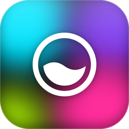
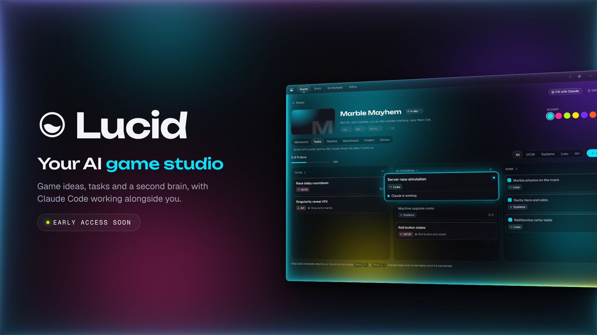
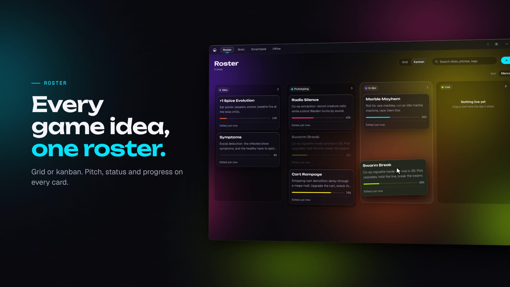
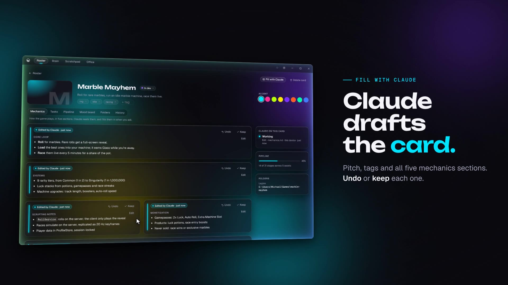
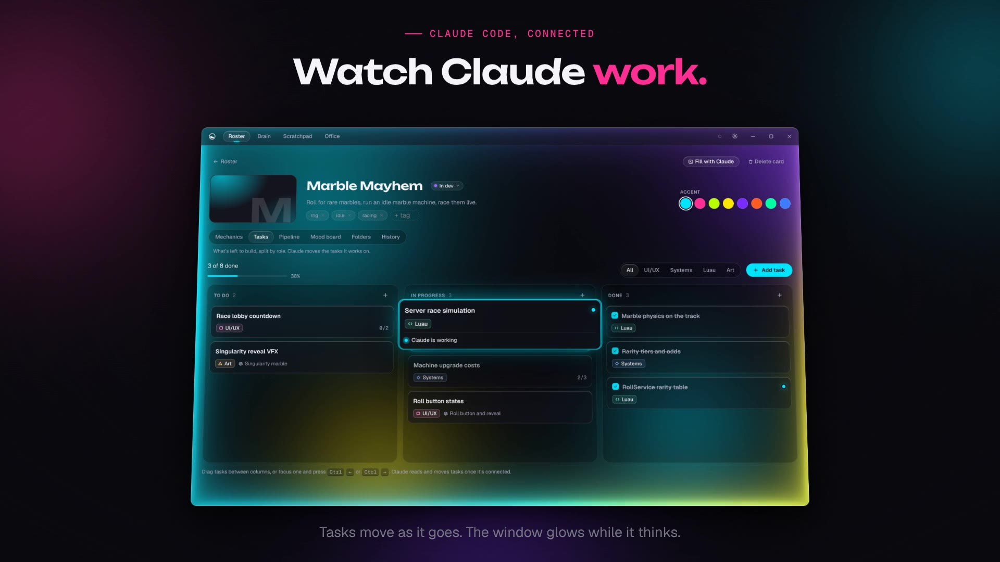
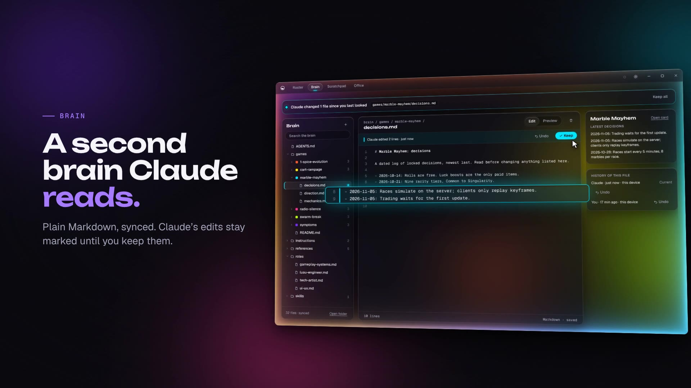
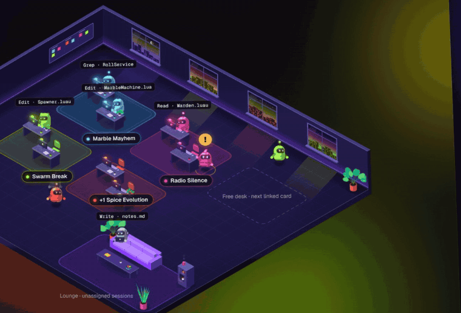
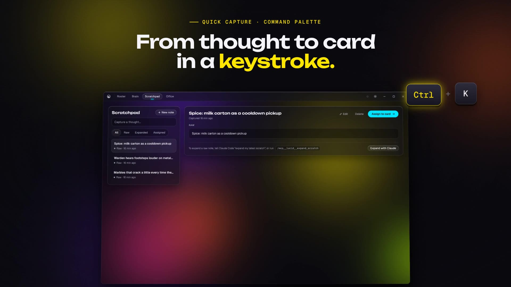
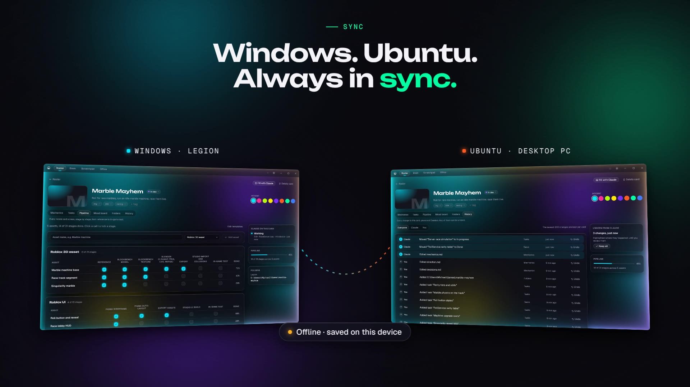

<div align="center">



# Lucid

**Your AI game studio.** Every game idea on one roster, a second brain that Claude Code reads, and a live view of Claude working on your games.

<a href="https://github.com/iveezor/Lucid-Environment/releases/latest"></a>


<br /><br />

<a href="https://github.com/iveezor/Lucid-Environment/releases/latest"></a>

<sub>Early access. Built for Roblox developers who work with Claude Code.</sub>

</div>

---

## What it does

<table>
<tr>
<td width="50%"></td>
<td width="50%">

### Every game idea, one roster
Each idea becomes a card with its pitch, status, mechanics, tasks, art pipeline and mood board. Switch between grid and kanban, drag to reorder, search everything.

</td>
</tr>
<tr>
<td width="50%">

### Claude drafts the card
Press **Fill with Claude** and Claude Code writes the pitch, tags and all five mechanics sections (core loop, systems, scripting notes, monetization, open questions). Nothing is saved until you approve it, and every change can be undone.

</td>
<td width="50%"></td>
</tr>
<tr>
<td width="50%"></td>
<td width="50%">

### Watch Claude work
Claude moves tasks as it builds, and the window edge breathes with light while it thinks. A permission prompt turns it amber, so you know when it needs you.

</td>
</tr>
<tr>
<td width="50%">

### A second brain Claude reads
Plain Markdown, synced across your computers: how you work, role guides for UI, systems, Luau and art, and a folder per game. Claude reads it at the start of every session; its edits stay highlighted until you keep them.

</td>
<td width="50%"></td>
</tr>
</table>

<div align="center">

### Every session, at its desk



Each Claude Code session walks into the Office as a little bot: typing at its game's desk while it works, wandering when idle, raising a **!** when it needs you.

</div>

<table>
<tr>
<td width="50%"></td>
<td width="50%"></td>
</tr>
<tr>
<td>

**From thought to card in a keystroke.** Quick capture from any app (Ctrl+Shift+Space, ⇧⌘Space on Mac) and a command palette for everything (Ctrl+K / ⌘K).

</td>
<td>

**Always in sync.** Windows, Ubuntu and macOS stay in step through your account, and Lucid keeps working offline.

</td>
</tr>
</table>

---

## Install

Download from the [latest release](https://github.com/iveezor/Lucid-Environment/releases/latest). Lucid updates itself after that.

<details open>
<summary><b>Windows 10 / 11</b></summary>

1. Download `Lucid_x.y.z_x64-setup.exe` and run it.
2. Windows SmartScreen may say the publisher is unknown (Lucid isn't code-signed yet): choose **More info**, then **Run anyway**.

</details>

<details>
<summary><b>Ubuntu (22.04 and newer)</b></summary>

```bash
sudo apt install ./Lucid_x.y.z_amd64.deb
```

Keep the `./` so apt installs the file instead of searching online. Installing a newer `.deb` the same way upgrades in place; your data stays.

</details>

<details>
<summary><b>macOS 12+ (Apple Silicon)</b></summary>

1. Open `Lucid_x.y.z_aarch64.dmg` and drag **Lucid** into **Applications**.
2. The first launch is blocked because Lucid isn't notarized by Apple yet. Open **System Settings → Privacy & Security**, scroll down and click **Open Anyway** next to the Lucid message.

</details>

### Connect Claude Code

Claude Code (a Claude Pro or Max plan) is what lets Claude read and fill your cards. Lucid walks you through it on first launch: **Settings → Claude Code** installs nothing behind your back, shows every change before making it, and Disconnect undoes all of it.

---

## Privacy and security

- Your data syncs through your own account; each account can only ever see its own rows and files.
- Claude Code reaches Lucid only through Lucid's own helper on your computer, which checks it's talking to your copy of Lucid before sending anything. Lucid never receives your prompts or the files Claude works on; it only learns which session is busy and which tool it's using.
- Claude changes cards only when you ask it to, and every change is listed in History with Undo.
- Each download comes with `SHA256SUMS.txt`, and updates are signed.

<div align="center">
<br />
<sub>Lucid is in early access. Found a bug or have an idea? Open an issue.</sub>
</div>
